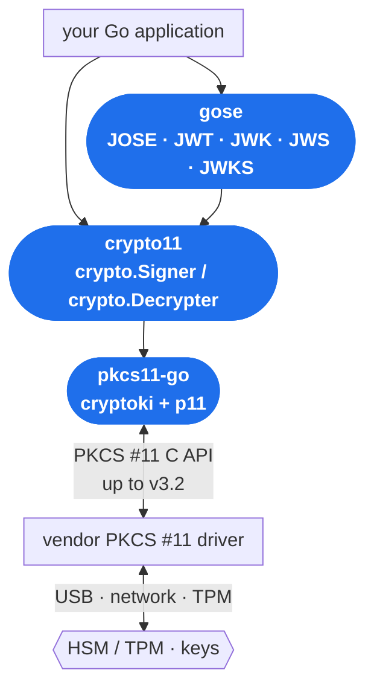

# Eclipse KeyPont 🔑

**Bridging Go applications to cryptographic keys held in HSMs and other PKCS#11-backed hardware.**

*KeyPont* — "key" plus the French *pont* ("bridge") — is the [Eclipse KeyPont](https://projects.eclipse.org/projects/technology.keypont)
project. It provides the PKCS#11 and JOSE building blocks that let Go code use keys which never leave a
hardware security module.

> [!NOTE]
> Looking for the Kubernetes side? The HSM-backed Kubernetes KMS v2 plugin lives in the sibling
> organisation **[Eclipse KeySealer](https://github.com/eclipse-keysealer)**.

## Projects

| Repository | What it is | Why you'd use it |
|------------|------------|------------------|
| [**pkcs11-go**](https://github.com/eclipse-keypont/pkcs11-go) | A Go binding for the [OASIS PKCS #11 (Cryptoki) v3.2](https://docs.oasis-open.org/pkcs11/pkcs11-spec/v3.2/pkcs11-spec-v3.2.html) cryptographic token interface, including post-quantum (ML-KEM / ML-DSA) and other v3.2 additions. Ships a low-level `cryptoki` binding plus an ergonomic `p11` API. | You need to talk to a PKCS#11 module directly, or you are building a higher-level library on top of one. |
| [**crypto11**](https://github.com/eclipse-keypont/crypto11) | An implementation of the standard Go `crypto` interfaces (`crypto.Signer`, `crypto.Decrypter`, …) backed by PKCS#11, built on `pkcs11-go`. | You want existing Go code that expects `crypto.Signer` to transparently use an HSM key — RSA, ECDSA, Ed25519, DSA, and ML-KEM. |
| [**gose**](https://github.com/eclipse-keypont/gose) | JOSE for Go: JWT, JWK, JWS and JWKS types, helpers and examples, with HSM-backed keys via `crypto11`. | You are issuing or verifying tokens and want the signing keys to live in hardware rather than in process memory. |

## How they fit together

Each layer builds on the one below it. `pkcs11-go` is the only project that talks to the vendor
PKCS#11 driver; everything above it stays in idiomatic Go.



<!-- The same graph, extended with k8s-kms-plugin, is on the Eclipse KeySealer organisation page;
     change both together. -->

<!-- Alternative: the richer draw.io diagram already in the k8s-kms-plugin repository, which also
     shows the downstream consumer. To use it instead of the Mermaid block above, copy
     docs/images/libs-imports-gose-crypto11-k8s-kms-plugin.svg into the .github repository and
     replace the fenced mermaid block with a Markdown image pointing at that copied file. -->

## Getting started

```sh
go get github.com/eclipse-keypont/pkcs11-go
go get github.com/eclipse-keypont/crypto11/v2
go get github.com/eclipse-keypont/gose
```

Each repository's README has a quick start, and the API reference is on
[pkg.go.dev](https://pkg.go.dev/github.com/eclipse-keypont/pkcs11-go).

## Security

All three repositories run a hardened CI pipeline — `golangci-lint`, `govulncheck`, CodeQL, secret
scanning, dependency review and an OpenSSF Scorecard gate — and tagged releases are signed and
SLSA3-attested. See each repository's README for how to verify a release.

### OpenSSF Scorecard

The [OpenSSF Scorecard](https://scorecard.dev/) rates a project's security practices from 0 to 10.
The badges below are live: they are drawn by shields.io from the public Scorecard API, so they track
the latest scan rather than a number frozen into this page. Click a badge for the per-check breakdown.

| Project | Score | Report |
|---------|:-----:|--------|
| [**pkcs11-go**](https://github.com/eclipse-keypont/pkcs11-go) | [](https://scorecard.dev/viewer/?uri=github.com/eclipse-keypont/pkcs11-go) | [checks](https://scorecard.dev/viewer/?uri=github.com/eclipse-keypont/pkcs11-go) |
| [**crypto11**](https://github.com/eclipse-keypont/crypto11) | [](https://scorecard.dev/viewer/?uri=github.com/eclipse-keypont/crypto11) | [checks](https://scorecard.dev/viewer/?uri=github.com/eclipse-keypont/crypto11) |
| [**gose**](https://github.com/eclipse-keypont/gose) | [](https://scorecard.dev/viewer/?uri=github.com/eclipse-keypont/gose) | [checks](https://scorecard.dev/viewer/?uri=github.com/eclipse-keypont/gose) |
| [**k8s-kms-plugin**](https://github.com/eclipse-keysealer/k8s-kms-plugin) <br/><sub>Eclipse KeySealer</sub> | [](https://scorecard.dev/viewer/?uri=github.com/eclipse-keysealer/k8s-kms-plugin) | [checks](https://scorecard.dev/viewer/?uri=github.com/eclipse-keysealer/k8s-kms-plugin) |

<!-- Scores at the time of writing (2026-10-20): pkcs11-go 8.0, crypto11 9.2, gose 8.1,
     k8s-kms-plugin 8.8. The badges above are live, so this comment is only a fallback if the
     shields.io endpoint is unavailable. -->

## Related

- [Eclipse KeySealer](https://github.com/eclipse-keysealer) — HSM-backed key management for Kubernetes
- [Eclipse KeyPont project page](https://projects.eclipse.org/projects/technology.keypont)
- [Eclipse KeySealer project page](https://projects.eclipse.org/projects/technology.keysealer)
